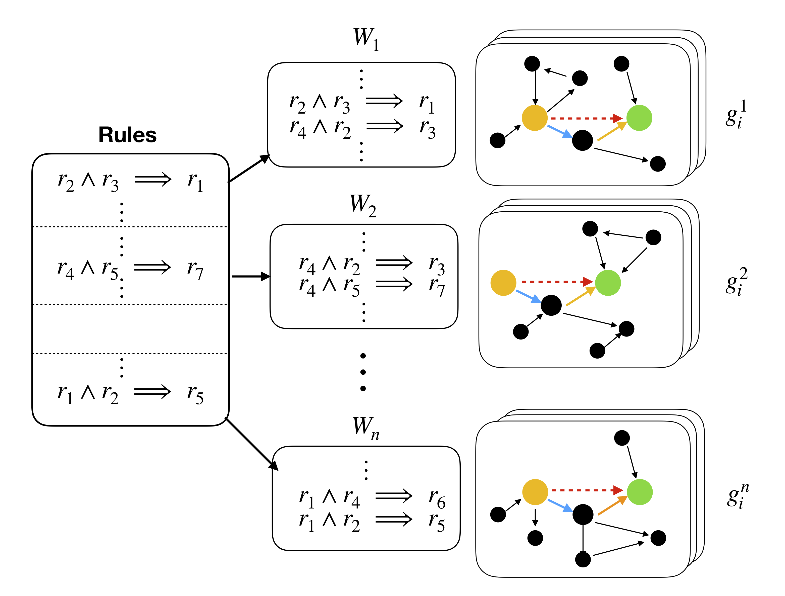

.. GraphLog documentation master file, created by
   sphinx-quickstart on Tue Mar 10 11:30:43 2020.
   You can adapt this file completely to your liking, but it should at least
   contain the root `toctree` directive.

GraphLog documentation
====================================

GraphLog is a multi-purpose, multi-relational graph dataset which is built
using rules grounded in first order logic. GraphLog can be used to benchmark
existing Graph Neural Network (GNN) family of models on relation prediction
task.

.. toctree::
   :glob:
   :maxdepth: 1
   :caption: Getting Started

   pages/install
   pages/usage
   pages/advanced

.. Indices and tables
.. ==================

.. * :ref:`genindex`
.. * :ref:`modindex`
.. * :ref:`search`

Paper
---------

GraphLog is published in the paper `“Evaluating Logical Generalization in Graph Neural
Networks” <#archive>`__. If you like using our dataset, consider citing our work.

